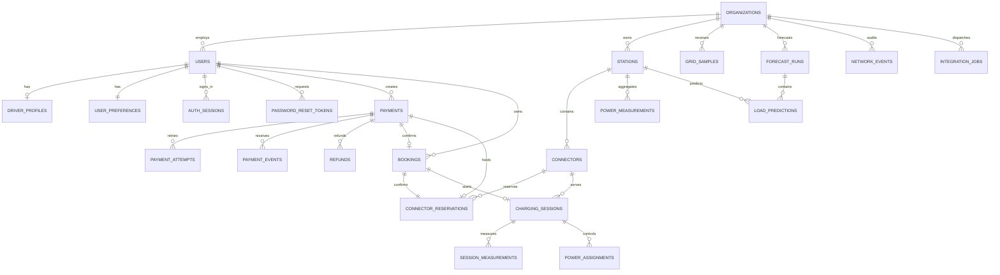

# Проектирование базы данных

Версия 1.1, 26 октября 2026 года. Целевая логическая схема PostgreSQL. Первые семь таблиц реализованы в [001_foundation.sql](../backend/migrations/001_foundation.sql) и проверены на PostgreSQL 17; остальная модель и SQL резервирования ниже ещё не реализованы. Дополнительная schema_migrations — технический журнал, не восьмая предметная сущность.

## Принципы

Строковый UUID по умолчанию используется для новых сущностей. Для станций допускается стабильный текстовый ID, чтобы сохранить существующие ссылки `tverskaya-plaza` и другие. Ключи API остаются строками. Время — `timestamptz`, измерения — `numeric` с явными единицами, денежные суммы — `bigint` в копейках, валюта — RUB в первой версии. Связи задаются внешними ключами; финансовая история не удаляется каскадно.

Текущий `Connector` во frontend — группа портов одного типа/мощности. Строка БД `connectors` — **один конкретный независимо резервируемый порт**. Несколько выходов с общей аппаратной мощностью потребуют отдельного ограничения зарядного устройства; для первой версии имитатора выходы считаются независимыми в пределах лимита станции.

## Основные связи



Связь `bookings → connector_reservations` обязательна для подтверждённой брони. До оплаты существует удержание без брони. В `load_predictions.station_id` допускается NULL для прогноза всей сети. Кратность ER показывает бизнес-связи; составные ограничения ниже уточняют их.

## Словарь таблиц

| Таблица | Основные поля | Назначение и ограничения |
| --- | --- | --- |
| organizations | id, name, network_limit_kw, created_at | Организация-владелец сети; лимит ≥ 0 |
| users | id, email_normalized, password_hash, name, phone, role, organization_id, disabled_at, created_at | UNIQUE email; role driver/operator; у оператора обязательна организация, роль меняется только служебной операцией |
| driver_profiles | user_id, vehicle_name, plate, preferred_connector_type, battery_capacity_kwh | Один текущий автомобиль водителя; ёмкость 10–250 кВт⋅ч; отсутствие профиля оператора нормально |
| user_preferences | user_id, booking_alerts, receipts, network_alerts, critical_alerts, load_alerts, reports | Один набор предпочтений на пользователя |
| auth_sessions | id, user_id, token_hash, expires_at, revoked_at, created_at | UNIQUE хеш; токен в открытом виде не хранится |
| password_reset_tokens | id, user_id, token_hash, expires_at, used_at, revoked_at | UNIQUE хеш; один действующий токен на пользователя обеспечивает сервис под блокировкой пользователя |
| stations | id, organization_id, name, address, district, longitude, latitude, max_power_kw, limit_kw, price_per_kwh_kopecks, operating_state, archived_at | Координаты longitude ±180, latitude ±90; 0 ≤ limit ≤ max; state online/offline/service; доступность вычисляется отдельно |
| connectors | id, station_id, label, type, max_power_kw, operating_state, archived_at | type CCS2/CHAdeMO/Type 2; UNIQUE (station_id,label); состояние idle/offline/service, занятость определяется сессией |
| payments | id, user_id, station_id, requested_connector_type, start_at, end_at, method, amount_kopecks, quoted_tariff_kopecks, quoted_energy_kwh, status, idempotency_key, request_hash, expires_at, created_at | Один неизменяемый заказ оплаты; UNIQUE (user_id,idempotency_key); состояние pending/succeeded/failed/cancelled |
| payment_attempts | id, payment_id, attempt_no, provider, provider_payment_id, status, confirmation_url, created_at | Повтор оплаты создаёт попытку, а не новый заказ; UNIQUE (payment_id,attempt_no), UNIQUE (provider,provider_payment_id) при наличии ID |
| payment_events | id, attempt_id, provider, provider_event_id, kind, received_at, processed_at | UNIQUE (provider,provider_event_id); сохраняются только нужные поля события без карточных данных |
| connector_reservations | id, payment_id, booking_id, connector_id, start_at, end_at, state, expires_at | Состояния held/confirmed/released/expired; один диапазон одного порта; payment_id UNIQUE, booking_id UNIQUE при наличии |
| bookings | id, user_id, station_id, connector_id, payment_id, start_at, end_at, amount_kopecks, status, created_at | payment_id UNIQUE; состояния confirmed/cancelled/used/expired; duration вычисляется из интервала |
| charging_sessions | id, booking_id, user_id, station_id, connector_id, started_at, ended_at, state, initial_soc, target_soc, battery_capacity_kwh, tariff_kopecks, start_meter_kwh, final_meter_kwh, energy_kwh, cost_kopecks | booking_id UNIQUE; состояния starting/active/stopping/completed/failed; снимки автомобиля/тарифа; одна незавершённая сессия на порт и пользователя |
| refunds | id, payment_id, session_id, amount_kopecks, reason, status, provider_refund_id, idempotency_key, created_at | session_id nullable при отмене/сбойной брони; состояния pending/succeeded/failed; UNIQUE ключ; сумма успешных и ожидающих возвратов не выше оплаченной суммы |
| session_measurements | id, session_id, sequence_no, measured_at, received_at, cumulative_energy_kwh, power_kw, soc_percent, connection, source | UNIQUE (session_id,sequence_no); source simulator/device; SOC nullable; фактические и запрошенные мощности не смешиваются |
| power_measurements | id, station_id, interval_start, interval_end, avg_power_kw, energy_kwh, active_sessions, station_limit_kw, network_budget_kw, source, quality | Агрегаты часовых интервалов для обучения; UNIQUE (station_id,interval_start,source); quality complete/partial/missing |
| grid_samples | id, organization_id, available_power_kw, base_load_kw, status, measured_at, received_at, source | Снимок внешнего бюджета; source simulator/external; статус normal/constrained/offline |
| forecast_runs | id, organization_id, generated_at, origin_at, model_version, dataset_version, dataset_source, metrics, training_from, training_to, test_from, test_to | Успешные расчёты; метрики JSONB с единицами/горизонтом/базовым методом; dataset_source measured/simulator/synthetic указывает происхождение набора. DTO source=model требует фактического запуска обученной модели; сведения о наборе добавляются отдельно |
| load_predictions | id, run_id, station_id, time, horizon_hours, power_kw | 24 последовательных точки на выбранный объект; power ≥ 0; уникальность сети и станции задаётся раздельными индексами |
| power_assignments | id, session_id, grid_sample_id, forecast_run_id, requested_kw, allocated_kw, applied_kw, created_at, acknowledged_at, status, reason | allocated — решение, applied — подтверждение устройства; applied nullable до ответа; статус pending/applied/failed |
| network_events | id, organization_id, station_id, actor_user_id, date, severity, action, message, metadata | Аудит изменений и интеграционных ошибок; актор nullable для фонового обработчика |
| integration_jobs | id, organization_id, kind, operation_key, entity_id, payload, status, attempt_count, available_at, locked_until, last_error, created_at | UNIQUE operation_key; сохранённые задания оплаты/возврата/запуска/остановки/мощности; секреты в payload не сохраняются |

Эти 23 таблицы вводятся несколькими миграциями по этапам. В первом backend нужны пользователи, организации, станции, порты и настройки; ML и внешние команды добавляются тогда, когда реализуются соответствующие процессы.

## Конкурентное резервирование

Для одного порта запрещены пересекающиеся интервалы со state held/confirmed. Оба типа находятся в **одной таблице**, иначе два независимых ограничения на платежи и брони не исключат конфликт между ними.

Ограничение реализовано в [миграции 002](../backend/migrations/002_reservations.sql) Stage 3A. Эта миграция создаёт только ядро резервов; payment_id и составная связь с заказом/портом/интервалом добавлены в 003; booking_id и бронь остаются для 3C. Текущий порт привязан FK, организация проверяется внутренним сервисом через station → connector; публичной записи резерва нет.

```sql
CREATE EXTENSION IF NOT EXISTS btree_gist;

ALTER TABLE connector_reservations
  ADD CONSTRAINT reservation_end_after_start CHECK (end_at > start_at),
  ADD CONSTRAINT reservation_no_overlap
  EXCLUDE USING gist (
    connector_id WITH =,
    tstzrange(start_at, end_at, '[)') WITH &&
  ) WHERE (state IN ('held', 'confirmed'));
```

Интервалы полуоткрытые: 12:00–13:00 и 13:00–14:00 не конфликтуют. В predicate нельзя использовать `now()` для автоматического исключения просроченных удержаний. Фоновый процесс и транзакция новой заявки явно переводят истёкшие held → expired; затем ограничение перестаёт учитывать строку. Пока очистка не прошла, возможен консервативный отказ, но двойного резерва нет.

Создание, освобождение и подтверждение удержаний одной станции используют согласованный порядок блокировок: платёж → станция → порт → резерв. В пути создания нового платежа платёж сначала вставляется/находится по ключу и блокируется, затем выбираются станция и порт. Все конкурирующие пути соблюдают этот порядок. Уникальность и exclusion constraint остаются последней защитой. Deadlock/serialization conflict обрабатывается ограниченным повтором транзакции.

В реализованном Stage 3A платежа ещё нет: станция блокируется FOR SHARE, подходящие порты — FOR UPDATE в порядке UUID, затем истёкшие резервы переводятся в expired. Кандидаты одного типа сериализованы для небольшого учебного каталога. GET availability только читает, исключает elapsed held из оценки и не гарантирует будущий резерв. Результаты независимых PostgreSQL-соединений — [R12/R13](testing/reservation-results.md).

Сервис проверяет, что connector.station_id, payment.station_id и booking.station_id совпадают и принадлежат разрешённой организации. Для sessions `(booking_id,user_id,connector_id,station_id)` защищается составным FK на уникальную комбинацию bookings. Такие же согласованные составные связи нужны при связывании резерва с бронью. Одних независимых FK на каждый ID недостаточно.

## Индексы и неизменяемая история

- users: UNIQUE email_normalized; auth_sessions: UNIQUE token_hash и индекс по user_id; сброс пароля: user_id/expires_at.
- stations: organization_id, archived_at; connectors: station_id и тип. При исходном масштабе фильтры координат работают без PostGIS. Геопоиск большого каталога — последующее расширение.
- bookings: (user_id,start_at DESC), (station_id,start_at); sessions: (user_id,started_at DESC), (station_id,state).
- sessions: частичные UNIQUE connector_id и user_id для starting/active/stopping. Для восстановления после сбоя не создаётся вторая строка: продолжается та же операция.
- reservations: GiST для пересечений; (state,expires_at) для очистки held; UNIQUE payment_id и booking_id.
- measurements: (session_id,measured_at), (station_id,interval_start); grid_samples: (organization_id,measured_at DESC).
- predictions: UNIQUE (run_id,station_id,time) WHERE station_id IS NOT NULL; UNIQUE (run_id,time) WHERE station_id IS NULL. Обычный UNIQUE с nullable station_id не защищает сетевые точки от дублей.
- jobs: (status,available_at); журнал: (organization_id,date DESC).

Станции и порты, имеющие историю, архивируются. Тариф и ёмкость батареи фиксируются в сессии; изменение профиля или тарифа не пересчитывает прошлую зарядку. Счётчик источника никогда не заменяется клиентским временем. Возврат является отдельной записью, а не отрицательной энергией.

## Состояния и вычисляемые данные

`Station.status` совместимого DTO вычисляется: service/offline при таком operating_state; available/busy по доступным портам и фактической нагрузке. При свежей нагрузке ≥ 85% станционного лимита — busy; отсутствие idle-портов также busy. Нет свежего измерения — loadPercent = null, а не 0. Статус доступности не является гарантией свободного будущего интервала.

Доступный порт **сейчас**: станция и порт работают, порт не занят незавершённой сессией и не удерживается/не забронирован на текущий интервал. Доступный порт **на выбранное время** дополнительно не имеет пересечения с held/confirmed резервом. Актуальная сессия без подтверждённой остановки блокирует порт независимо от окончания её броневого интервала.

Количество available/total для frontend агрегируется по `(type,max_power_kw)`; суммарная свободная мощность не хранится отдельным «истинным» полем. Её считают из свежего бюджета, лимитов и измерений; при отсутствии свежих показаний она неизвестна.

Внутренние состояния expired/starting/stopping/failed и источник simulator богаче текущего DTO. Перед использованием этих состояний HTTP frontend расширяется; нельзя выдавать starting как active или simulator как настоящее device.

## Обязательные проверки будущих миграций

Две конкурентные заявки, соседние интервалы, истечение удержания, повтор webhook, поздняя оплата после освобождения порта, чужой connector_id, повтор запуска, параллельная остановка, изменение тарифа/профиля во время зарядки, повтор измерения, некорректная последовательность энергии, ограничения двух организаций и восстановление после рестарта.

DDL-пример резервирования основан на [официальной документации PostgreSQL об ограничениях диапазонов](https://www.postgresql.org/docs/17/rangetypes.html); он реализован в миграции 002 и расширен связью платежа в 003. Первая миграция и её [результаты проверки](testing/backend-results.md) покрывают только Foundation.

## Фактическая схема Stage 3B

[003_payments.sql](../backend/migrations/003_payments.sql) добавляет payments, payment_attempts и payment_events. Reservation.payment_id уникален; составной FK гарантирует один и тот же заказ, порт и интервал. Дополнительные составные ключи защищают организацию станции и тип порта. Уникальны user/key, payment/attempt_no, payment/retry_key и provider/event_id; частичный индекс допускает одну pending-попытку заказа.

Триггер запрещает менять снимок (включая цену/период/TTL/ключ/hash) и стирать полученный provider success. Временный CHECK 3B запрещает business succeeded: успех остаётся у attempt/event. В confirmation_url хранится базовый URL без capability; события содержат разрешённые поля/hash без сырого payload и карточных данных.

Создание 3B сериализовано по user advisory lock; новый заказ/hold/attempt виден только после общего commit. Операции существующего заказа сначала берут payment FOR UPDATE, затем станцию/порт/резерв. Ограниченный повтор deadlock/serialization и exclusion остаются защитой. [Конкурентные проверки P05/P06/P18/P19](testing/payment-results.md). Остальная полная ER-модель остаётся целевой.

## Фактическая схема 004: атомарная бронь и компенсация

[004_booking_finalization.sql](../backend/migrations/004_booking_finalization.sql) расширяет временный payment_stage3b_status значением succeeded, сохраняя 001–003 и payment_order_immutable. Bookings уникальны по payment, reservation и funding attempt. Составные FK защищают user/organization/station/connector/type/interval/amount/method. Обратные FK и deferred constraint triggers проверяют согласованность payment + confirmed reservation + booking при commit; временные промежуточные записи внутри транзакции допустимы, несогласованный commit — нет.

payment_compensations хранит неизменяемый снимок причины/суммы/attempt/provider refund ID и pending/submitted/succeeded. test_refund_receipts отделён от намерения; составной FK с confirmed_at и проверка суммы запрещают ложный completed и удаление подтверждающей квитанции. Точность времени квитанции сохраняется SQL-копированием timestamptz, без потери микросекунд через JS Date. [F00–F21](testing/booking-finalization-results.md) покрывают транзакции, миграцию, сбои и восстановление.

## Фактическая схема Stage 3D — миграция 005

001–004 не изменяются. Booking сохраняет неизменный снимок, допускает confirmed→used/cancelled. Новые таблицы:

| Таблица | Назначение и защита |
| --- | --- |
| charging_sessions | UNIQUE booking; составные FK снимка booking/payment; partial UNIQUE незавершённых user/connector; монотонная энергия, terminal freeze |
| session_measurements | Wh/W, PG timestamp, source=simulator, sequence unique, monotone; immutable; повтор sequence с иным содержимым запрещён |
| charging_commands | Уникальная start/stop на session, provider ID, ready/confirmed time, deliveries; terminal freeze |
| charging_command_requests | user/key PK, request hash, составные owner/command FK |
| simulator_devices | Внутренние online/reject/delay; нет публичного API изменения |
| simulator_session_state | Сохраняемые energy/дробная работа/sequence/epoch; восстановление без backfill |
| simulator_command_receipts | Неизменяемое подтверждение устройства и связанное измерение |
| session_settlements | UNIQUE session, FK final measure/command, копеечная формула, immutable |
| session_refunds | UNIQUE session/settlement/provider ID; pending/submitted/succeeded, точная сумма остатка |
| test_session_refund_receipts | Отдельная неизменяемая квитанция остатка, deferred FK для подтверждения |

Deferred session_result_consistency не допускает active без start receipt и used booking, completed без stop receipt/final reading/settlement, failed без отрицательного start receipt и нулевой энергии. Общий refund_budget_guard учитывает стоимость, 3C-компенсации и все намерения остатков; сумма не превышает реально успешные попытки оплаты, включая бюджет каждой попытки. Квитанция требует совпадения provider ID/amount/time. Финансовые данные и показания после завершения не исправляются задним числом. [005 SQL](../backend/migrations/005_charging_sessions.sql), [тестовый протокол](testing/charging-results.md).

## Фактическая схема Stage 3E — миграция 006

Booking допускает confirmed→used/cancelled/expired при неизменном снимке. `booking_closures` (booking PK, reason driver/no_show, PG closed_at) неизменяема. `booking_refunds` (UNIQUE booking/provider ID, полный amount и funding attempt через составной FK) хранит pending/submitted/succeeded. `test_booking_refund_receipts` — отдельная неизменяемая квитанция; deferred FK требует provider ID/amount/confirmed_at.

booking_consistency сохраняет succeeded payment/booking/attempt связи, разрешая только cancelled+released и expired+expired. booking_lifecycle_consistency требует closure/refund без любой session; отмена сессии допускается только при terminal zero-energy settlement без подтверждённого старта, без booking refund. booking_operation_guard блокирует payment/booking при INSERT session/closure, сериализуя гонку. refund_budget_guard расширен на booking refunds, сохраняя 3C/3D бюджеты. Исторические 001–005 неизменны. [006 SQL](../backend/migrations/006_booking_lifecycle.sql), [протокол](testing/booking-lifecycle-results.md).

## Stage 4A — управление станциями оператора

Миграция 007, аудит network_events и ключи operator_requests; API управления собственной организацией, физические порты, безопасные лимиты/режим/архив, HTTP формы и история. Создание service → проверенные порты → online. Архив не удаляет финансовую историю. Диагностика без показаний: «Нет данных». GridAdapter/max-min/ML/OCPP не включены. [Политика, тесты и приёмка](testing/operator-management-results.md). Публичный выпуск PENDING.


## Stage 4B — Operator Monitoring

PostgreSQL readings → scoped monitoring API → HTTP operator UI. Derived hourly power_measurements uses strict-adjacent-v1; missing/partial never means zero. Separate measured/allocated power, unknown Grid budget, exact settlement kopecks, simulator source, bounded keyset history and CSV. [Protocol](testing/operator-monitoring-results.md). Public acceptance is pending until release PR evidence.


## Stage 5A — shadow Grid planning

GridAdapter simulator, integer-W max-min, durable immutable planning snapshots, scoped idempotent scenario commands and separate audit. No device power changes. [Contract, tests and acceptance](testing/grid-planning-results.md). GRID_FRESHNESS_SECONDS: 5–3600 (default60). Stage 5B requires acknowledged setPower and interval-safe metering.

## Применение мощности: миграция 010

Добавлены power_dispatch_settings/actions, immutable power_dispatch_plans (Grid sample,
fingerprint всех материальных входов, live assignments), power_commands (stable provider
ID, revision, pending/submitted/acknowledged/rejected), immutable power_command_receipts,
session_power_state и immutable session_power_history/effective_at. Разрешены 0 Вт
как подтверждённая пауза; allocated_power_w остаётся неизменяемым стартовым снимком.
Deferred constraints связывают state, последний transition, intent, receipt, session/org
и target плана. Raw measurement_guard сверяет power с historical confirmation на
sampled_at и сохраняет монотонность энергии/seq. Старые shadow constraints сохранены.
Upgrade восстанавливает подтверждения из durable start/stop receipts, legacy managed=false.
ERD: [power-dispatch.mmd](diagrams/power-dispatch.mmd).
