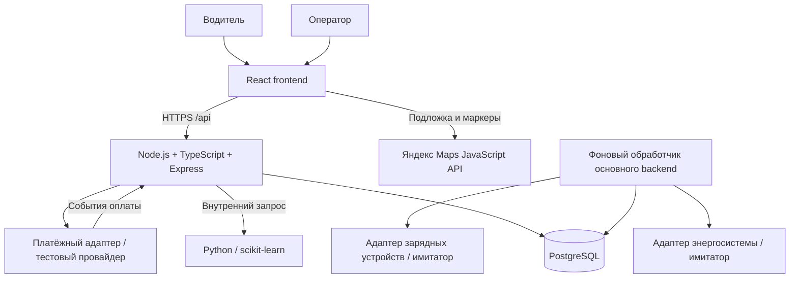

# Архитектура «Энерготранспорта»

Версия 1.1, 26 октября 2026 года. Целевая архитектура. Локально реализован [Backend v0.1](../backend/README.md): auth/users/catalog/workspace и PostgreSQL. ML, платежи, бронирования, зарядные устройства и управление мощностью ниже остаются проектными компонентами.

## Компоненты и размещение

Frontend остаётся на GitHub Pages. API и PostgreSQL размещаются отдельно либо работают локально для защиты. Публичный frontend подключается к публичному HTTPS API; обычный `localhost` API для посетителей Pages не является адресом удалённого сервера. Бесплатное размещение backend подбирается отдельно с учётом актуальных ограничений провайдера.

Основной backend — модульный монолит. ML — один небольшой отдельный процесс: он позволяет использовать Python без переноса основной бизнес-логики. Redis, брокер сообщений, Kubernetes и дополнительные микросервисы для обязательной версии не нужны. Фоновые задания и очередь внешних команд сохраняются в PostgreSQL.

## Модули backend

| Модуль | Ответственность |
| --- | --- |
| auth | Вход, регистрация только водителя, хеширование паролей, отзыв токенов, восстановление |
| users | Профиль, снимок автомобиля для сессии, предпочтения |
| catalog | Станции, физические порты, интервальная доступность, группировка DTO для карты |
| bookings | Подтверждение, отмена, истечение и атомарное резервирование порта |
| payments | Предварительная стоимость, попытки оплаты, события провайдера, возвраты и идемпотентность |
| charging | Запуск/завершение, телеметрия, энергия, итоговый расчёт |
| operator | Сводка, изменение инфраструктуры, настройки и аудит действий |
| power | Ограничения сети, распределение мощности, журнал и подтверждение внешних команд |
| forecast | Подготовка доступных на момент расчёта признаков, запрос ML и сохранение прогнозов |
| jobs | Истечение удержаний, имитатор, повторы внешних команд и расчёт мощности |

Обработчик HTTP валидирует запрос и вызывает сервис. Сервис управляет транзакцией и правами. Доступ к БД находится в репозитории модуля; HTTP-обработчик не содержит расчёт мощности или SQL резервирования. SQL-миграции хранятся в Git; ORM не обязателен. Для первой реализации достаточно `pg` и параметризованных запросов.

## Согласованность и внешние события

1. Создание оплаты атомарно записывает платёж, снимок заказа и временное удержание конкретного порта. Повтор одного ключа возвращает ту же операцию; другой запрос с прежним ключом возвращает 409.
2. Запрос к провайдеру выполняется после фиксации транзакции, с тем же ключом идемпотентности. При сбое попытка остаётся восстанавливаемой; фоновые повторы не создают новый заказ.
3. Уведомление провайдера проверяет подпись, принадлежность, сумму, валюту и идентификатор попытки. Нельзя подтвердить платёж по query-параметру страницы возврата или по нажатию пользовательской кнопки.
4. Подтверждение в одной транзакции блокирует платёж и удержание, записывает уникальное событие, создаёт ровно одну бронь и переводит удержание в подтверждённый резерв.
5. Если успех пришёл после истечения и порт уже занят, бронь не создаётся. Платёж сохраняет факт успешной оплаты, а отдельный возврат и команда его исполнения записываются атомарно. Это состояние надо показать в интерфейсе при подключении возвратов.
6. Завершение зарядки сначала запрашивает/подтверждает остановку устройства. Последнее достоверное показание определяет итог; повтор остановки возвращает тот же результат. Недоступное устройство не считается успешно остановленным.

Служебная таблица `integration_jobs` хранит внешние команды, ключ операции, число попыток и результат. Запись команды и изменения состояния выполняются вместе. Работник берёт задание с блокировкой, применяет операцию идемпотентно и сохраняет ответ. Несколько работников допустимы только при таком захвате заданий; для защиты достаточно одного.

## Доступ

Сохраняется существующий `Authorization: Bearer`. Начальная реализация использует криптографически случайные непрозрачные токены: клиент получает значение, БД хранит только хеш, пользователя, срок и отметку отзыва. Проверка каждого запроса делает выход и смену пароля действительно отзывающими вход. JWT и refresh-токены не обязательны для учебного объёма.

Оператор связан с организацией; запросы фильтруются по этой организации. Администратор создаёт аккаунт служебной командой. Данные другого водителя и не относящиеся к организации финансовые данные не включаются в `/workspace`. Тестовые управляющие маршруты недоступны в режиме реальных интеграций.

## Энергосистема и алгоритм мощности

`GridAdapter.read()` возвращает `availablePowerKw`, `baseLoadKw`, `status`, `receivedAt`, `source`. `availablePowerKw` означает общий доступный бюджет участка, а `baseLoadKw` — потребление вне зарядок. Бюджет зарядной сети:

`B = max(0, min(operatorLimitKw, availablePowerKw - baseLoadKw))`.

Имитатор меняет доступную мощность по заданному сценарию. Устаревший статус сети не позволяет увеличивать ранее подтверждённую выдачу. Если достоверного бюджета вообще нет, автоматический запуск приостанавливается и оператор видит причину. Порог свежести и аварийный режим задаются конфигурацией адаптера.

Для активной сессии `d_i = min(requestedPowerKw, connectorMaxPowerKw)`. На первом этапе применяем равноправное max-min распределение: каждая сессия получает общую равную долю, малые запросы насыщаются, остаток перераспределяется. Ограничения каждой станции учитываются в общей задаче:

`0 ≤ p_i ≤ d_i`, `sum(p_i для станции s) ≤ stationLimit_s`, `sum(p_i) ≤ B`.

При прогрессивном заполнении доли растут вместе до насыщения запроса, станции или сети; насыщенная сессия/станция прекращает получать прибавку. Результат детерминирован, не превышает ограничения и не делает бессистемных приоритетов. Пример для запросов 100, 80, 60, 50 кВт при B = 150 кВт и свободных лимитах станций: **37,5 кВт каждой машине**. Цифры 55/40/30/25 требуют отдельной политики весов и не используются как необъяснённый результат.

Перерасчёт — после запуска/остановки, изменения лимита, поступления нового grid-статуса и периодически. Алгоритм производит запрошенные задания мощности; фактическая мощность определяется подтверждённой телеметрией. Разница между командой и показанием отображается, а не затирается расчётным значением.

## ML и его границы

Первая цель модели — прогноз **измеренной суммарной мощности зарядок** на каждый из ближайших 24 часов. Это не прогноз неограниченного спроса: фактическая мощность уже зависит от действующих лимитов. Обучающие данные должны содержать эти лимиты и источник измерений.

Для первого опыта сравниваем RandomForestRegressor с двумя базовыми методами: последнее наблюдение и тот же час предыдущей недели. Это выбранный кандидат, а не обещание превосходства. Признаки: станция, будущий час/день недели, лаги до момента расчёта, известные лимиты, текущая нагрузка. Будущее число активных сессий и фактическая будущая температура в признаки не попадают. Можно использовать известные брони или доступный тогда прогноз погоды, если такие данные реально собираются.

Для 24 часов предпочтительна прямая модель с признаком горизонта `h=1..24`: все лаги берутся до одного момента `origin`, целевое значение — `origin+h`. Часовой ряд приводится к регулярной сетке, пропуски и качество измерений отмечаются. Прогноз сети проверяется по одинаковым часовым интервалам суммирования станций; отдельно считаются метрики для станций и сети.

Источники: реальные измерения, данные имитатора или синтетический набор. Они не смешиваются без метки. Первое обучение на воспроизводимом синтетическом наборе подтверждает работу конвейера, но не качество на настоящей сети. Дни, сценарии и начальное значение генератора тестовой части отделяются от обучения. Последний временной период остаётся нетронутым до итогового сравнения; временная валидация имеет зазор не меньше максимального горизонта метки. MAE/RMSE приводятся в кВт с датами, горизонтом и базовым методом; выдуманный «процент точности» не показывается.

Прогноз сначала применяется как предупреждение оператору. Жёсткие лимиты всегда задаёт энергосистема и конфигурация, а не модель. Автоматический резерв мощности с учётом прогнозируемого пика — дополнительный эксперимент: его включают только после сравнения сценариев по недоотпущенной энергии, ожиданию и нарушениям ограничений. При отсутствии/ошибке модели основной алгоритм продолжает работать по достоверному текущему бюджету.

## Подключение к frontend

Сохраняем совместимые DTO и существующий `/workspace`. Для станции БД хранит отдельные longitude/latitude, а API возвращает `[longitude, latitude]`. Физические порты агрегируются по типу и мощности. Текущие строковые ID допустимы; транспортный контракт не требует числового ID.

Дополнения: формы станции и порта; интервальная доступность; возврат; неизвестный SOC при отсутствии данных устройства; состояния запуска/остановки, ожидающих подтверждения. Диапазоны мощности и правило «лимит сети не ниже суммы лимитов станций» из mock нельзя считать физическими законами: перед включением распределения эти ограничения должны зависеть от конфигурации и допускать дефицит.

HTTP-режим включается только после готовности необходимых API. Мок остаётся отдельным сценарием демонстрации и тестирования. Данные localStorage не импортируются на сервер как доверенные пользователи или платежи; миграции наполняют БД контролируемыми демонстрационными данными.

Основания для проектных решений: [PostgreSQL: интервалы и exclusion constraints](https://www.postgresql.org/docs/17/rangetypes.html), [scikit-learn: временная проверка прогноза](https://scikit-learn.org/stable/auto_examples/applications/plot_time_series_lagged_features.html), [TimeSeriesSplit](https://scikit-learn.org/stable/modules/generated/sklearn.model_selection.TimeSeriesSplit.html).
