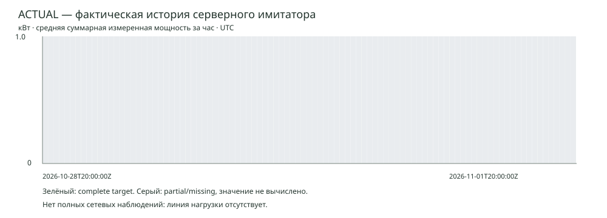
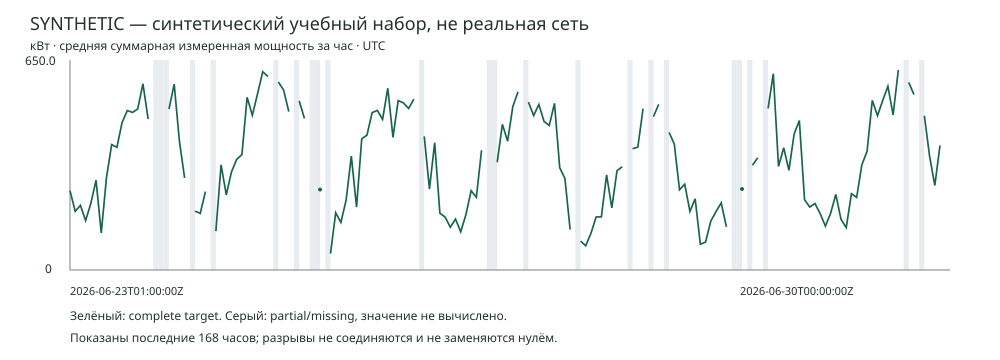

# Stage 6A — ML Data Readiness + Baseline Forecasting

Статус: LOCAL ACCEPTANCE PASS / PUBLIC ACCEPTANCE PENDING.
Исходный main: `a49ee240d8e44aaea20e442265b7edaaa3756b69`.

## Read-only аудит фактической истории

Neon PostgreSQL 17, организация учебного стенда. SELECT выполнен 1 ноября 2026,
20:11 UTC; снимок не меняет таблицы. Raw: 260 показаний, 14 сессий, 304 Grid samples,
36 power transitions. Raw период: 2026-10-27 10:06:48 — 2026-11-01 11:57:50 UTC.
Derived период: 2026-10-28 19:00 — 2026-11-01 13:00 UTC, 12 исторических станций
(включая архивные QA), 90 различных часовых интервалов, 912 station-hour строк.
Worker пересчитывает до 48h; сохранённая история не гарантирует непрерывное покрытие.

| Station-hour quality | n | Доля |
|---|---:|---:|
| complete | 0 | 0% |
| partial | 7 | 0.7675% |
| missing | 905 | 99.2325% |

Gap/boundary counters в сохранённых агрегатах равны 0, raw gap flags — 0.
Это не означает покрытия: отсутствие readings само создаёт missing. Архивные станции
учитываются по created_at/archived_at. Expected roster сравнивается с полным набором
станционных интервалов; current catalog не используется для переписывания прошлого.

Экспорт дополнил отсутствующие часы до последнего закрытого часа audit (20:00 UTC),
получилось 97 сетевых часов: 0 complete, 5 partial (5.1546%), 92 missing (94.8454%).
Все полные network targets null, обе baseline имеют n=0, MAE/RMSE=null.
Это не нулевая нагрузка. Сумма известных станционных subset не является сетевой нагрузкой.
Только у 2 из 97 границ часа есть известный свежий Grid sample, созданный/полученный
до origin с возрастом не более его TTL. Остальные ограничения неизвестны, не 0.
Snapshot limits — конфигурация на момент экспорта; в исторические признаки не входят.

**Решение для фактической истории: NEEDS_MORE_DATA.** Причины: нет пригодных complete
сетевых часов, период короче недели, нерегулярные короткие учебные сессии, нет непрерывных
станционных heartbeat даже в idle. До реального обучения нужны независимые подтверждённые
idle/online нулевые показания и непрерывное полное покрытие, а не заполнение missing нулями.
Изменение источника/агрегации — отдельный этап; Stage 6A не меняет strict-adjacent-v1.

## Synthetic dataset

Отдельный synthetic-network-v1: 2026-01-01 00:00 — 2026-06-30 00:00 UTC,
180 дней × 24 = 4320 часов, 8 неодинаковых станций, seed=20261101.
3677 complete (85.1157%), 554 partial (12.8241%), 89 missing (2.0602%).
Почасовая/недельная сезонность, binomial active sessions, случайный спрос/lognormal noise,
неодинаковые ports/physical station caps, max-min целых Вт и сеть 650 кВт; эпизоды
дефицита 140 кВт и recovery ramp. Раздельные RNG спроса и качества. Нет обучения RF.
Future counts/demand/noise/Grid не экспортируются в признаки. Synthetic measured average
— модель часового режима, не кривая настоящей зарядной сессии; intra-hour dynamics не проверяются.
Telemetry station gaps/partial и сетевые outage даются отдельным механизмом.
Синтетика не поступает в Neon и не смешивается с фактическим snapshot.

## Разделение и предотвращение leakage

Target: average measured total charging network power, kW, в UTC часе [end−1h,end).
Origin — UTC hour boundary; h=1..24 — следующие end timestamps. Actual availability
не раньше max(end,built_at); synthetic idealizes availability=end. Это допущение учтено.
Нет случайного split, imputation, normalization или feature selection по общему набору.
Параметры генератора и baseline зафиксированы до оценки, test только для фиксированной
оценки; не используется для выбора будущих RF features/параметров.

| Блок target timestamps, half-open | Кандидатных origins | Origins с общими оценками | Общих origin/h пар |
|---|---:|---:|---:|
| train: [2026-01-01T00:00:00Z, 2026-05-01T00:00:00Z) | 2855 | 2711 | 47682 |
| validation: [2026-05-02T00:00:00Z, 2026-05-30T00:00:00Z) | 648 | 648 | 10963 |
| test: [2026-05-31T00:00:00Z, 2026-06-30T00:00:00Z) | 696 | 696 | 11634 |

Gap: [2026-05-01,2026-05-02) и [2026-05-30,2026-05-31), по 24h.
Дополнительно origin допускается только если все 24 target часа в его блоке.
Точные first/last origin и результаты по каждому h сохранены в baseline-metrics.json.
Пересекающиеся прогнозы внутри блока не являются статистически независимыми часами;
pooled метрика взвешивает допустимые origin/h пары, не выдаётся за доверительный интервал.

## Два фиксированных baseline

Last: последнее complete измерение с end<=origin и available_at<=origin.
Weekly: exact target end минус 168h, также известное на origin. При отсутствии
необходимой истории — null, без fallback на ноль или другой baseline. Сравнение только
на одинаковых complete targets и общем support обеих оценок.

| Split | Last MAE, кВт | Last RMSE, кВт | Weekly MAE, кВт | Weekly RMSE, кВт | n у каждого |
|---|---:|---:|---:|---:|---:|
| train | 164.664137 | 211.823146 | 106.452452 | 146.54091 | 47682 |
| validation | 157.747787 | 207.099264 | 121.327187 | 163.67158 | 10963 |
| test | 152.688055 | 199.321876 | 116.180936 | 159.35778 | 11634 |

| Test horizon | Last MAE / RMSE, кВт | Weekly MAE / RMSE, кВт | common n |
|---|---:|---:|---:|
| 1 | 62.364249 / 87.179546 | 116.113948 / 159.612973 | 482 |
| 10 | 209.363353 / 256.300047 | 116.189812 / 159.386221 | 485 |
| 11 | 215.779724 / 263.707663 | 116.127802 / 159.269999 | 486 |
| 12 | 215.899704 / 261.866932 | 116.243905 / 159.310295 | 486 |
| 13 | 216.462389 / 262.440032 | 116.177712 / 159.269525 | 486 |
| 14 | 207.704403 / 253.973381 | 116.225784 / 159.279253 | 486 |
| 15 | 198.10221 / 239.625531 | 116.181183 / 159.269883 | 486 |
| 16 | 190.831195 / 232.042728 | 116.357177 / 159.324705 | 486 |
| 17 | 173.630305 / 215.769795 | 116.430689 / 159.361131 | 486 |
| 18 | 157.275535 / 196.291936 | 116.430689 / 159.361131 | 486 |
| 19 | 140.856456 / 175.553117 | 116.251094 / 159.202843 | 487 |
| 2 | 81.642902 / 111.070191 | 116.250689 / 159.649071 | 482 |
| 20 | 122.889004 / 157.537844 | 116.000068 / 159.018023 | 487 |
| 21 | 109.301442 / 140.781057 | 116.212337 / 159.180473 | 486 |
| 22 | 91.954739 / 120.741921 | 116.0385 / 159.103274 | 486 |
| 23 | 86.120305 / 114.18141 | 115.777549 / 158.936507 | 486 |
| 24 | 81.676337 / 109.980035 | 115.660342 / 158.875387 | 486 |
| 3 | 98.335635 / 129.661253 | 116.198888 / 159.63513 | 482 |
| 4 | 122.336174 / 158.439937 | 116.192687 / 159.63239 | 482 |
| 5 | 140.569282 / 181.418649 | 116.300969 / 159.690093 | 482 |
| 6 | 162.885876 / 204.647566 | 116.218644 / 159.562707 | 483 |
| 7 | 179.000253 / 221.45894 | 116.256153 / 159.583065 | 483 |
| 8 | 195.834602 / 238.845196 | 116.256153 / 159.583065 | 483 |
| 9 | 202.471064 / 248.147529 | 116.252651 / 159.503146 | 484 |

## Воспроизведение и приёмка

Python 3.14.5, стандартная библиотека; команды и схема времени: [ml/README](../../ml/README.md).
`cd ml`, затем `python -m readiness prepare`, `python -m unittest discover -s tests -v`.
Повторная генерация проверяет точное равенство dataset hash и baseline metrics, CI сравнивает
все tracked results без зависимости от БД/даты запуска. Audit/export/validate/baseline доступны отдельно.
Snapshot и его происхождение сохранены в ml/data; CSV/JSON/SVG и manifest — в ml/results.

- snapshot_sha256: `fa94bb1edd2fb68a1e5c6dbbaf45c4170a34c7c00f7cbf94cac9bea8452f94c8`
- actual_sha256: `298cc4f2cef192427dc7143eb98039958bf16b5bae20c4d0327e5da5e1de4ad0`
- synthetic_sha256: `2f39bfa1271973d03c3231ec148b7c868afa5f94730d8895e654480ddac9583e`

12 новых Python проверок: export roster/quality, stable seed/hash/metrics, другой seed,
physical budget, origin availability, future perturbation, weekly alignment/no fallback,
purged target blocks, общая база метрик, запрет partial→0 и будущего Grid.
Прежние 193 backend и 90 frontend сохраняются; финальные прогоны и публикация фиксируются
в release PR после CI, merge, Render/Pages same SHA и публичной регрессии.

**READY только для контролируемого synthetic эксперимента Stage 6B.**
Реальная история NEEDS_MORE_DATA. Хорошие результаты на synthetic не означают качество
на реальных электромобилях или безопасность dispatch. Baseline не является обученной ML-моделью.
План/спецификация RF: [Stage 6B](../stage6b-model-plan.md). Forecast API и рабочий UI не меняются.

Локально: 193/193 прежних backend + 1/1 новый PostgreSQL export test, 90/90 frontend,
12/12 Python, build/lint PASS. Baseline CLI выдаёт 24 последовательные nullable точки;
пример сохранён в ml/results/baseline-example.json. Финальная публичная приёмка PENDING
до отчёта в выпускном PR, без нового deploy только ради статуса документа.
