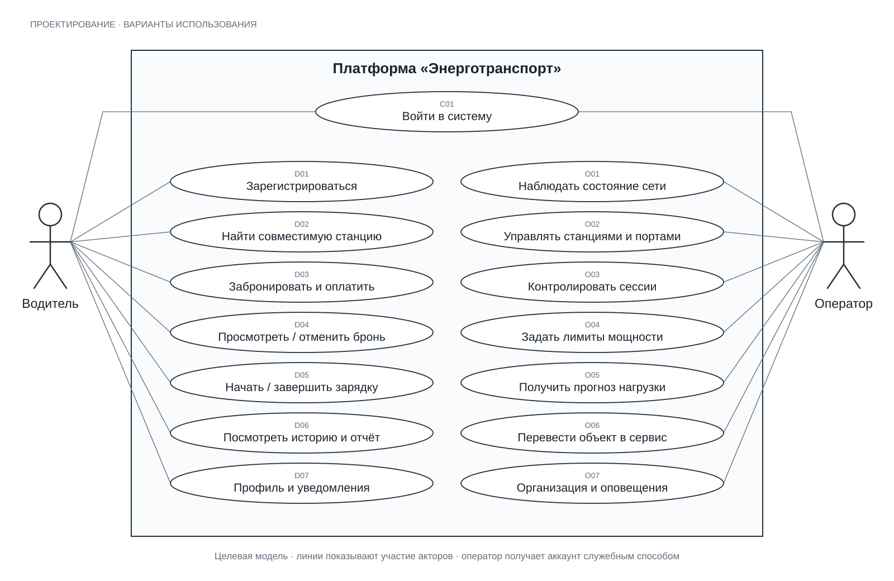

# Варианты использования

Версия 1.0, 6 октября 2026 года. Описывают целевую платформу; наличие варианта на диаграмме не означает, что серверная функция уже реализована. Две основные роли — Водитель и Оператор. Оператор не регистрируется публично.

[Исходник диаграммы SVG](diagrams/use-cases.svg) пригоден для масштабирования и включения в записку; есть [PNG для вставки](diagrams/use-cases.png) и [генератор](diagrams/generate-use-cases.mjs) (`node docs/diagrams/generate-use-cases.mjs`). Эллипсы — пользовательские цели, прямоугольник — граница платформы, линии — участие акторов. Это обзор, а не последовательность экранов. Внешние адаптеры и служебный администратор показаны отдельно в [архитектуре](system-architecture.md).

## Каталог целей

| ID | Актор | Цель | Требования | Текущее состояние |
| --- | --- | --- | --- | --- |
| C01 | Водитель, оператор | Войти в систему | F01–F02 | Интерфейс и mock |
| D01 | Водитель | Зарегистрироваться | F01–F02 | Интерфейс и mock |
| D02 | Водитель | Найти совместимую станцию | F03–F04 | Реальная подложка карты, каталог mock |
| D03 | Водитель | Забронировать и оплатить разъём | F05–F06 | Локальная демонстрация |
| D04 | Водитель | Просмотреть и отменить бронь | F07 | Mock; серверный возврат спроектирован |
| D05 | Водитель | Начать и завершить зарядку | F08–F09 | Локальный симулятор |
| D06 | Водитель | Посмотреть историю и отчёт | F15 | Mock и CSV |
| D07 | Водитель | Настроить профиль и уведомления | F16 | Mock; доставка уведомлений отсутствует |
| O01 | Оператор | Наблюдать состояние сети | F09–F10 | Интерфейс и mock |
| O02 | Оператор | Управлять станциями и портами | F04, F10 | Часть настроек mock; CRUD будущий |
| O03 | Оператор | Контролировать зарядные сессии | F08–F10 | Интерфейс и mock |
| O04 | Оператор | Задать лимиты мощности | F13–F14 | Настройки mock; алгоритм будущий |
| O05 | Оператор | Получить прогноз нагрузки | F12 | График demo; модель будущая |
| O06 | Оператор | Перевести объект в сервис | F11 | Проверки локального симулятора |
| O07 | Оператор | Настроить организацию и оповещения | F10, F16 | Mock; сервер и доставка будущие |

Восстановление доступа — альтернативный сценарий C01 с одноразовым токеном и отзывом входов; служебная выдача аккаунта оператору находится вне D01. Групповые цели D05/D07/O02 детализируются самостоятельными API-операциями в контракте.

## C01: вход

**Предусловие:** учётная запись существует и не заблокирована. **Основной ход:** пользователь выбирает роль, вводит данные; сервер проверяет пароль и фактическую роль; создаёт отзываемую сессию входа и возвращает token/user; клиент открывает соответствующий кабинет. **Постусловие:** вход связан с одним пользователем, в БД находится только хеш токена.

**Альтернативы:** неверные данные дают нейтральный 401; выбор чужой роли не меняет права; истёкший/отозванный токен прекращает доступ. При восстановлении применяется одноразовая ссылка; её повторное применение отклоняется. Саморегистрация operator запрещена независимо от запроса клиента.

## D03: бронирование и тестовая оплата

**Предусловия:** водитель вошёл; станция и совместимый порт работают; интервал находится в будущем. **Триггер:** подтверждение формы бронирования.

1. Клиент отправляет станцию, тип разъёма, интервал и метод оплаты с ключом идемпотентности.
2. Сервер вычисляет цену, выбирает физический порт, атомарно создаёт временное удержание и заказ оплаты.
3. Платёжный адаптер выдаёт страницу подтверждения; водитель проходит тестовую оплату.
4. Backend проверяет событие адаптера; в одной транзакции создаёт одну бронь и подтверждает резерв.
5. Клиент получает подтверждённый сервером результат и показывает бронь.

**Постусловие:** один платёж связан с одной бронью и одним портом на непересекающемся интервале.

**Альтернативы:** порт уже занят → 409 без второй брони; повтор того же запроса → тот же заказ; отказ оплаты → понятный повтор; истечение → освобождение удержания; поздний успех после конфликта → возврат, без фиктивного подтверждения брони. Цена не принимается от клиента. Все тестовые исходы названы тестовыми.

## D05: зарядка

**Предусловия:** собственная подтверждённая бронь, разрешённый момент старта, нет другой незавершённой сессии на порт/пользователя; сетевой бюджет доступен. **Основной ход:** водитель запрашивает старт; сервер фиксирует снимки тарифа/автомобиля и команду; имитатор подтверждает запуск; поступают показания; водитель запрашивает остановку; после подтверждения сервер фиксирует итог и историю.

**Альтернативы:** чужая бронь → отказ; повтор старта/остановки → прежняя операция; нет подтверждения устройства → состояние ожидания/ошибки, а не успех; потеря связи → сохранение последнего показания с предупреждением; остаток предоплаты → тестовый возврат. Изменение профиля не меняет уже начатую сессию.

## O02/O06: инфраструктура и обслуживание

**Предусловия:** оператор принадлежит организации-владельцу. **Основной ход:** оператор создаёт/редактирует объект; сервер проверяет координаты, мощности, тип и принадлежность; сохраняет изменения и аудит; каталог возвращает обновлённый объект. При сервисном режиме проверяются активные процессы.

**Альтернативы:** объект другой организации → отказ; превышение аппаратной мощности → ошибка валидации; активная зарядка/резерв препятствуют опасному изменению; использованный в истории объект архивируется вместо удаления. Статус отправленной команды отделён от её подтверждения.

## O04: ограничение мощности

**Предусловия:** известны свежий сетевой бюджет и ограничения оборудования. **Основной ход:** оператор задаёт лимит; сервер проверяет пределы, пересчитывает распределение и сохраняет команды; адаптер подтверждает применение; UI показывает выделенную и фактическую мощности.

**Альтернативы:** запрос выше лимита → корректное ограничение долей; потеря grid-связи → предупреждение и запрет необоснованного увеличения; ошибка команды → ошибка, а не новое измерение. ML не может отменить жёсткое ограничение энергосистемы.

## O05: прогноз

**Основной ход:** оператор запрашивает обновление; сервер использует признаки, известные до момента расчёта; модель создаёт 24 точки; backend сохраняет версию и происхождение данных; UI показывает график и время расчёта. **Альтернативы:** данных недостаточно → отсутствующий прогноз; ошибка модели → предыдущий расчёт с предупреждением; синтетический набор → явная метка источника, без обещания качества на реальной сети.

Для сценариев подготовлен [тест-план](testing/test-plan.md). Связь с пользовательскими проблемами приведена в [персонах и карте боли](personas-and-pain-map.md).
